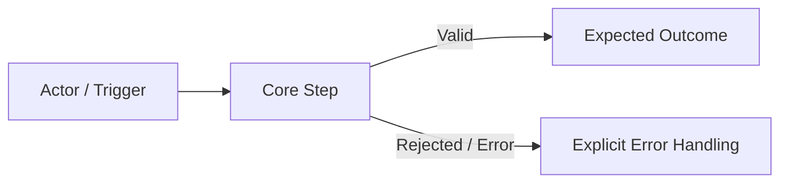

# Requirements Review Brief Template (3-Layer UX + SDD Contract)

Use this template when drafting the final Requirements Brief in `interview-for-requirements`.

## Authoring Rules

- Keep Layer 1 strictly derived from Layer 3. If Layer 3 changes, update Layer 1 before freezing the brief.
- Avoid repeating full scope bullets or decision options across sections: keep Layer 1 to one-line pointers and place full option trade-offs only in Section 7 Decision Cards.
- Include a Mermaid diagram in Layer 2 only when branching logic, state transitions, or multiple actors make prose harder to scan. Omit it for simple linear flows.
- Assign active `R-01`..`R-99` and `AC-01`..`AC-99` IDs only to in-scope Slice 1 items. List Later Slices as plain bullets without `R-NN` IDs so `sdd-02` crosswalk checks pass.
- Keep `OBSERVED_FACT` entries in Section 5, separate from `R-NN` requirements. Do not state unverified absences (such as missing internal tools) or unverified Owner identities as confirmed facts; mark them as `[ASSUMPTION]` or `unverified`.
- Keep every `D-NN` Decision Card scannable with explicit options, trade-offs, downstream impact, and Owner.

## Template

```markdown
# Requirements Brief: <Feature or Problem Title>

## Layer 1: 1-Minute Review Snapshot
- **Status**: `COMPLETE_BRIEF` | `PARTIAL_BRIEF (BLOCKED_ON_USER_DECISION)`
- **Problem (What & Why)**: <1-2 plain sentences explaining what is broken or missing today and why solving it matters.>
- **Slice 1 (Smallest Verifiable Solution)**: <1 sentence stating the minimal end-to-end capability delivered first.>
- **Open Blocking Decisions**: `<count>` (`None` or list `D-01..Dn` with Owner)

## Layer 2: Visual Flow & Concrete Example

### Key Flow (Conditional: omit if linear)


### Concrete Example (Normal vs. Exception)
- **Normal case**: <Input / trigger> -> <Observed output or state change>
- **Exception case**: <Boundary or invalid input> -> <Expected rejection, message, or fallback>

## Layer 3: Canonical Engineering & SDD Contract

### 1. Goal, Actors & Scope
- **Goal**: <Concise objective> (source: <user turn / doc>)
- **Actors**: <Who uses, operates, or approves this> (source: <user turn / doc>)
- **In Scope (Slice 1)**: <Minimal verifiable unit>
- **Deferred (Later Slices, no active R-NN IDs)**:
  - <Future capability 1>
- **Non-Goals**: <Explicitly out of scope> (source: <user turn / doc>)

### 2. Conceptual Solution Approach & Trade-offs
- `[PROPOSED_DEFAULT]` <Conceptual flow, system boundaries, and how Slice 1 solves the problem without specifying files or code tasks.>
- **Key Trade-offs**: <What this approach optimizes for vs. what it trades off.>
- **Confirmed User Constraints**: <Any requester-mandated constraint kept as `[CONFIRMED]`, or `None`.>

### 3. Confirmed Requirements (Slice 1 Only)
- `R-01` `[CONFIRMED, <source>]`: <Unambiguous requirement>
- `R-02` `[CONFIRMED, <source>]`: <Unambiguous requirement>

### 4. Observable Completion Criteria
- `AC-01` (verifies `R-01`): <Given/When/Then or observable pass/fail condition>
- `AC-02` (verifies `R-02`): <Boundary or failure condition>

### 5. Observed System & Repository Facts (Read-Only Evidence)
- `F-01` `[OBSERVED_FACT, <path>:<line or symbol>, <date/rev>]`: <Verified system fact>

### 6. Proposed Defaults & Unconfirmed Assumptions
- `[PROPOSED_DEFAULT]` <Reversible default and condition under which it changes>
- `[ASSUMPTION]` <Unverified premise and impact if false>

### 7. Blocking Open Decisions & Safe Parallel Work
| ID | Decision Question | Options & Trade-offs | Downstream Impact | Owner |
| --- | --- | --- | --- | --- |
| `D-01` | <Blocking question> | A: <option + trade-off> / B: <option + trade-off> | <What this blocks> | <Authorized role/person or unverified> |

- **Safe Parallel Work (Read-Only)**: <Repository inspection or impact analysis safe to run while awaiting `D-01..Dn`.>
```
